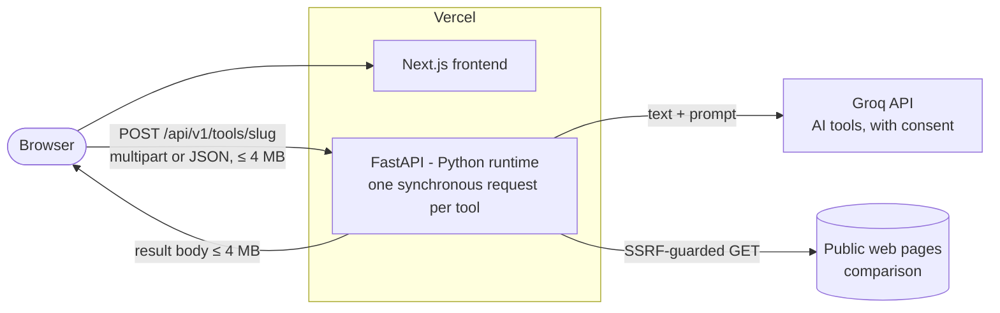

# Architecture Overview

Status: accepted (final for the contract freeze) · Owner: software-architect · Last updated: 2026-11-01

> Positioning: "Your files. Your privacy. Our tools. Nothing stored permanently."
> Engineering stance: every file is processed inside the single request that carries it and is returned in the response. We keep no storage for user content. We still do **not** claim absolute zero retention (see [privacy.md](privacy.md)).

Decisions: [ADR-0006](adr/0006-synchronous-processing-on-vercel.md) (synchronous, in-request, no storage) · [ADR-0007](adr/0007-ai-tools-groq.md) (AI tools) · [ADR-0004](adr/0004-pdf-and-conversion-libraries.md) (libraries) · ADR-0003/0005 deferred to Phase 7 · ADR-0001/0002 superseded.
Contract: `shared/openapi.yaml`, `shared/tool-catalog.schema.json` (api-designer; these win on conflicts).

---

## 1. Scope and NFRs

| Area | Target |
|---|---|
| Hosting | Vercel only: two projects, `frontend/` (Next.js) and `backend/` (FastAPI, Python runtime). **Hobby plan = demo/prototype tier** (§5). |
| Request size | **≤ 4 MB per request** (all files plus fields), which keeps us under Vercel's ~4.5 MB body cap. |
| Response size | **≤ 4 MB**. A larger output fails with `413 output_too_large` and the result is not returned. Tools cap their outputs (DPI, page count) to stay under this. |
| Duration | 60 s hard (`maxDuration`). Target p95 < 5 s for file tools and < 20 s for AI tools. Overruns return `504 processing_timeout`. |
| Memory budget | Design to **512 MB peak per request**, conservatively even if the plan allows more. Enforced through caps on pages (≤ 200), image pixels (≤ 40 MP) and DPI (≤ 150). |
| Storage | None. No S3, Redis, database, cron or queue. Supabase arrives only in Phase 7. |
| Retention | Content exists only in request memory and a request-scoped `/tmp` directory, which is deleted in `finally` before the response completes. |

**Out of scope**: OCR, Office conversions, HTML→PDF (WeasyPrint dropped), LibreOffice, Tesseract, Ghostscript, PyMuPDF, background jobs, large files.

## 2. Architecture

Request flow (every tool):
1. Size guard, then catalog lookup by `slug`.
2. Magic-byte sniffing and options validation.
3. `with scratch() as s:` the tool runs on `s` paths, using pure functions in `services/*`.
4. The result is streamed back with `Content-Disposition: attachment` and `Cache-Control: no-store`.
5. `finally` removes the scratch directory.

AI and comparison tools return JSON, or a text/markdown result, the same way. No job ids, polling, tickets or tokens.

### Backend modules (`backend/app`)

| Module | Responsibility |
|---|---|
| `core/` | settings (pydantic-settings), allowlist logging, problem+json errors, catalog loader |
| `middleware/` | request id, security headers, CORS, body-size guard (4 MB) |
| `api/` | `health`, `tools` (catalog + dispatcher to one handler per slug) |
| `storage/scratch.py` | **The single temp-file helper** (ADR-0006). The only code allowed to create files. |
| `services/pdf`, `services/image`, `services/extract`, `services/sign` | pure functions `(input paths, options, scratch) -> output path` |
| `services/comparison/fetcher.py` | the only general outbound HTTP client (SSRF guard) |
| `services/ai/groq_client.py` | the only client for Groq (ADR-0007) |

CI bans `tempfile`, `open(` with write modes, and raw `httpx` usage outside these modules.

### Tool set (pure Python, in-process)

| Category | Tools | Libraries |
|---|---|---|
| organize | merge, split (returns a ZIP), rotate, reorder/delete pages | pypdf, pikepdf |
| optimize | compress | pikepdf, Pillow |
| security | protect, unlock, basic signature | pikepdf, pyHanko |
| convert-to-pdf | image → PDF | img2pdf, Pillow |
| convert-from-pdf | PDF → JPG/PNG (≤ 150 DPI, output ≤ 4 MB), PDF → text, tables → CSV | pypdfium2, pdfplumber |
| edit | image convert/resize | Pillow |
| ai | summarize, translate, markdown, Q&A (text or PDF text ≤ input cap) | pdfplumber + Groq |
| compare | webpage comparison | httpx, BeautifulSoup, difflib |

### Platform rules
- **`/tmp` is not cleaned between requests.** A warm instance keeps it, and with fluid compute, concurrent requests share an instance. So `scratch()` must delete its directory in `finally`, and no content may live in module globals or caches.
- One Vercel project holds one set of environment variables. The only secret in the API before Phase 7 is the Groq key. From Phase 7, auth and payment secrets go in a **separate** Vercel project, so a parser bug cannot reach them.

## 3. Deployment

| Piece | Local | Vercel |
|---|---|---|
| Frontend | `npm run dev` | project root `frontend/` |
| API | `uvicorn` (compose with the API only; `backend/Dockerfile` for dev parity) | project root `backend/`, region `sin1`, `maxDuration` 60 |
| Secrets | `.env` (git-ignored) | Vercel env vars: `GROQ_API_KEY` and AI model ids |

## 4. Risks

| # | Risk | Mitigation |
|---|---|---|
| R1 | Peak memory on 4 MB PDFs with many pages, or high-resolution images | Page, pixel and DPI caps. A benchmark corpus in CI. |
| R2 | Abuse with no rate-limit store | Vercel Firewall rules if available on the plan (verify). Otherwise a best-effort per-instance limiter, plus a hard spend cap on the Groq account. |
| R3 | Untrusted files are parsed in the same process as the Groq key | Pinned and patched libraries, caps, a 60 s limit. Groq key scoped to one project, with a spend limit. Accepted residual risk for the demo tier. |

## 5. Hosting tier notes
The Hobby plan is accepted as the **demo/prototype tier**. Two points need correcting first:
- To our understanding, Hobby is limited to **personal, non-commercial use**. Charging customers requires Pro, so Phase 7 (payments) depends on upgrading the plan.
- The "12" figure is a past cap on functions per deployment, not 12 invocations per day. Our API is one FastAPI function, so this does not constrain us.

Duration and memory limits are designed conservatively (§1). Verify the current Hobby quotas before launch.

## 6. Phase 1 scope and ownership

**Phase 1**:
- Backend skeleton:
  - config, allowlist logging, security headers, CORS, 4 MB body guard;
  - `GET /health` and `/ready`, and `GET /api/v1/tools` (+ `/{slug}`);
  - `storage/scratch.py` implemented and tested;
  - `vercel.json`.
- Catalog listing the §2 tools as `coming_soon`.
- Frontend: home, nav, all-tools page and tool landing routes.
- compose with the API only, CI.

Tool handlers arrive from Phase 2, and auth and payments in Phase 7.

| Owner | Writes |
|---|---|
| api-designer | `shared/openapi.yaml`, `shared/tool-catalog.schema.json`, `docs/api.md` |
| backend | `backend/**` except `backend/Dockerfile`; `shared/tool-catalog.json` |
| frontend | `frontend/**` |
| infra | `backend/Dockerfile`, `infrastructure/**`, `compose.yaml`, `.github/**`, `Makefile`, root dotfiles, root `README.md` |
| architect | `docs/architecture.md`, `docs/adr/**`, `docs/privacy.md`, `docs/security.md` |
